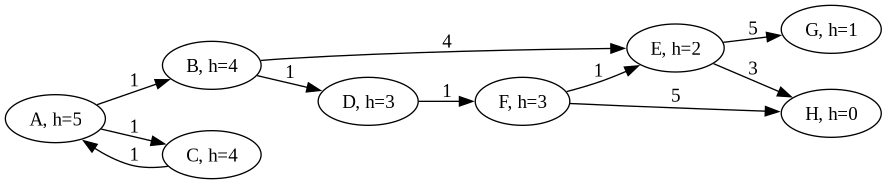
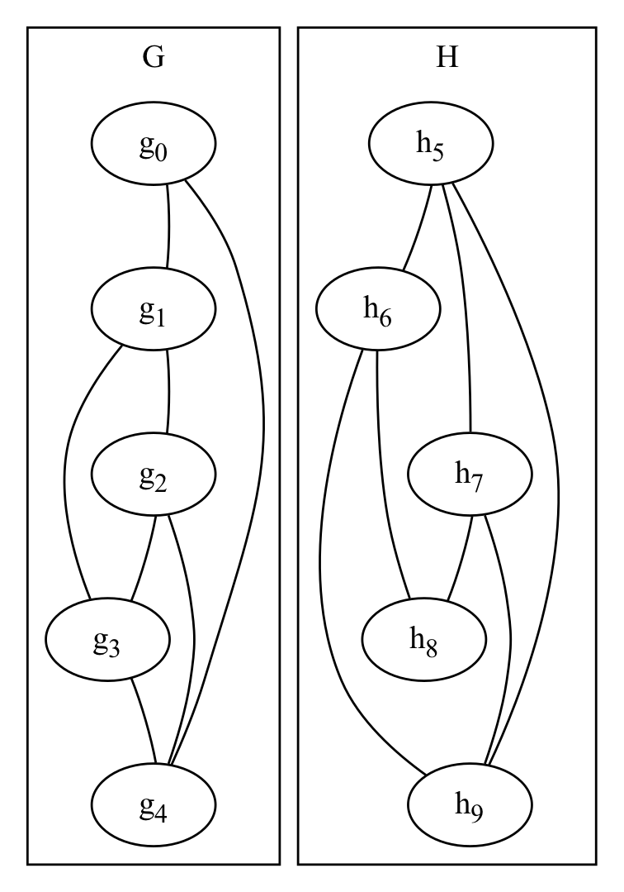

# Worksheet 5: Graphs

Initial due date: 2026-11-16 23:59 PT

## Review

Apply each of the following graph search algorithms to the graph below, to find a path from A to H. The number after `h=` in each node is the heuristic distance to H.

1. depth-first search
2. breadth-first search
3. Dijkstra's (also known as uniform cost search in AI settings)
4. greedy best-first search
5. A*

For each graph search algorithm, fill out a table like the one below. The Frontier column is the list of nodes to visit (in the order they will be visited); the Path column is the path from A to the current node; the Visited column are all the nodes that have been visited; and the New Neighbors column are the nodes to be added to the frontier. For Dijkstra's, greedy best-first search, and A\*, use parenthesis to indicate the cost, the heuristic, and the cost and heuristic respectively. For this question, you should add nodes/paths to the frontier in dictionary (lexicographical) order, so AB would be added to the frontier first, then AC. The table currently shows the first three rows of depth-first search, with (unnecessary) parentheses included as an example. Include in the table nodes that do not end up on the path from A to H.

| Step | Frontier        | Path | Visited | New Paths        |
| ---- | --------------- | ---- | ------- | ---------------- |
| 1    | A (0)           | A    | A       | AB (1), AC (1)   |
| 2    | AC (1), AB (1)  | AC   | A, C    | ACA (2)          |
| 3    | ACA (2), AB (1) | ACA  | A, C    |                  |

## Explore

In this section, we will be thinking through an algorithm that can solve the [graph isomorphism problem](https://en.wikipedia.org/wiki/Graph_isomorphism_problem). The Wikipedia article is rather dense, so instead, consider the two graphs below:

The graph isomorphism problem asks whether the nodes and edges of two graphs G and H can be paired together, so that every node in G has a corresponding node in H (and vice versa). Furthermore, if gi is paired with hi (for all _i_), and an edge exists between gi and gj, there must also be an edge between hi and hj (and vice versa). This problem is important in many applications, with one example being whether two chemical molecules are the same, or if they are simply made of the same atoms (but connected differently).

1. Are the two graphs in the image isomorphic? If so, what is the pairing of nodes in G to nodes in H?

2. If the graph G has _M_ nodes and the graph H has _N_ nodes, and _M_ is not equal to _N_, could G and H be isomorphic? Similarly, if G has _E_ edges and H has _F_ edges, and _E_ is not equal to _F_, could G and H be isomorphic? Why/Why not?

3. If the graphs G and H both have _N_ nodes, how many possible pairings of nodes are there? Justify your answer.

4. One common approach to solving graph isomorphism is to start with an empty pairing, then incrementally add potential node pairs, backtracking as necessary. This can be framed as a state space search. Given this description, what are the nodes/states for this problem, and what are the edges/actions?

5. Would this be an informed search or an uninformed search? Justify your answer.

6. Reducing the number of edges/actions as much as possible would speed up the search. What checks should be performed before adding a new edge/state to the frontier, to ensure that the resulting pairings are valid?

## Challenge

1. Select *one* of the following graph algorithms:

    * The [Floyd-Warshall algorithm](https://en.wikipedia.org/wiki/Floyd%E2%80%93Warshall_algorithm) for the [All-Pairs Shortest Path problem](https://en.wikipedia.org/wiki/Shortest_path_problem#All-pairs_shortest_paths).

    * The [Edmonds-Karp algorithm](https://en.wikipedia.org/wiki/Edmonds%E2%80%93Karp_algorithm) for the [Maximum Flow problem](https://en.wikipedia.org/wiki/Maximum_flow_problem).

    * [Kahn's algorithm](https://en.wikipedia.org/wiki/Topological_sorting#Kahn's_algorithm) to find a [Topological Sorting](https://en.wikipedia.org/wiki/Topological_sorting) of a graph.

    For the algorithm you selected, answer the questions below:

    1. What problem is the algorithm is trying to solve? What does it mean to solve the problem? What kind of graph (directed, weighted, etc.) does this algorithm work on? What is the output of the algorithm?

    2. Broadly, how does the algorithm work? You don't need to give pseudocode, but you might write (for example) "loop through each node and add up the weights of all incoming and outgoing edges".

    3. What is the run time complexity of this algorithm? Justify your answer using the algorithm description you gave above.

2. In this question, we will take a bigger view of the data structures and algorithms we have learned this semester and apply them to implement a social network. The core class is `Person`, which could contain information such as first and last names, email, phone number, etc. For each question, explain both the runtime complexity of the data structure(s) and algorithm(s) you are using, as well as the complexity of adding and removing someone from the social network under those data structure(s) and algorithm(s). Note that some questions may require nested data structures.

    1. What data structure(s) and algorithm(s) would you use to find people by their phone number? To avoid leaking other people's numbers, this should only work if the number is an exact match.

    2. What data structure(s) and algorithm(s) would you use to find people by their first and/or last name? This should work such that if you type "McC", everyone whose first or last name begins with "McC" should show up.

    3. What data structure(s) and algorithm(s) would you use to find people who has their birthday in the next two weeks? Assume there is "birthday" field that contains a `Date` class that has `month` and `date` member variables.

    4. What data structure(s) and algorithm(s) would you use to represent the friendships between people? Assume that friendships are reciprocal (that is, if person A is friends with person B, person B is also friends with person A).

    5. Use your answer to the previous question, but now take yourself out of the social network. What data structure(s) and algorithm(s) would you use to determine how many unrelated/separate groups of friends you have? Two friend groups are "unrelated"/"separate" if no one in a group knows anyone in the other.
