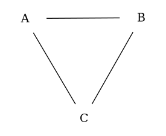
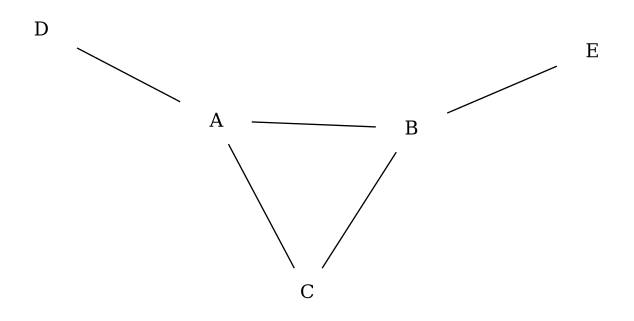
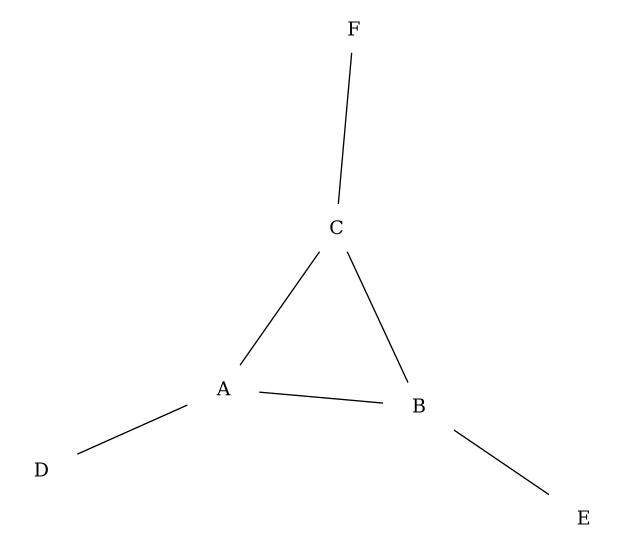

# Worksheet 6: NP-Completeness

Initial due date: 2026-11-22 23:59 PT

## Review

1. Define the following terms

    1. A decision problem
    2. A "witness" or "certificate" of a decision problem
    3. The complexity class P
    4. The complexity class NP
    5. The complexity class NP-hard
    6. The complexity class NP-complete
    7. A polynomial-time reduction

2. Consider how reductions can be used to prove that a problem is NP-complete, by trying to reduce a known NP-complete Problem H to another Problem X. It is a proof by contradiction:

    > 1. Assumption: Problem H is NP-complete, that is, it takes more than polynomial time to find a solution.
    > 
    > 2. Assumption: We can reduce instances of Problem H to instances of Problem X in polynomial time, such that the instance of Problem H has the same answer as the instance of Problem X.
    > 
    > 3. Hypothesis: Problem X only takes polynomial time to find a solution.
    > 
    > 4. If Hypothesis 3 is true, then we could give a correct answer to any instance of Problem H by:
    > 
    >     1. reducing it to the instance of Problem X (which takes polynomial time, by Assumption 2)
    > 
    >     2. solving that instance of Problem X (which takes polynomial time, by Hypothesis 3)
    > 
    >     3. converting the solution of Problem X back to a solution of Problem H (the inverse process of Assumption 2, therefore takes polynomial time)
    > 
    > 5. Since each of these steps take polynomial time, together, they would allow us to answer the instance of Problem H in polynomial time.
    > 
    > 6. This contradicts Assumption 1, so Hypothesis 3 must be wrong: it must take more than polynomial time to find a solution to Problem X. Specifically, Problem X must be as hard as Problem H (ie. it is NP-hard).
    > 
    > 7. If we further show that Problem X is in P, we would have showed that Problem X is NP-complete.

    In your own words, explain the logic behind this process and why it can be used to show that a problem is NP-complete.

## Explore

In this and the next section section, we will apply the process above. For this section, Problem H, the problem that we know to be NP-complete, is the undirected Hamiltonian Path (HP) problem. Problem X, the problem we are trying to show is NP complete, is the Hamiltonian Cycle (HC) problem. As the name suggests, these problems are already pretty similar. HP asks if there is a path that visits every node exactly once, while HC has the additional constraint that you must end where you start (ie. the path must be a cycle/loop).

Coming up with a reduction is difficult, so the focus here is on you understanding how this reduction works. The details can be found in [this Geeks for Geeks page](https://www.geeksforgeeks.org/dsa/proof-that-hamiltonian-cycle-is-np-complete/), as well as other places online.

1. In your own words, explain the Hamiltonian Path problem and why it is in NP (that is, why it only takes polynomial time to verify a solution).

2. In your own words, explain the Hamiltonian Cycle problem and why it is in NP (that is, why it only takes polynomial time to verify a solution).

3. The heart of a reduction is how to convert an instance of HP into an instance of HC. In this case, given an undirected graph (for HP), we can create a new graph a single new node, that is connected to every existing node. For the following graphs for HP, draw the reduced graph for HC.

    1. 

    2. 

    3. 

4. Explain why creating the reduced graph takes polynomial time.

5. Of your graphs above, which of them have a Hamiltonian cycle? Attach pictures of those solutions.

6. We now need to show the second half of Assumption 2 above.
    
    1. If there is a Hamiltonian path in the original graph, why must there also be a Hamiltonian cycle in the reduced graph?

    2. If there is _no_ Hamiltonian path in the original graph, why is it impossible for there to be a Hamiltonian cycle in the reduced graph?

    3. If there is a Hamiltonian cycle in the reduced graph, why must there also be a Hamiltonian path in the original graph?

    4. If there is _no_ Hamiltonian cycle in the reduced graph, why is it impossible for there to be a Hamiltonian path in the original graph?

We have now shown that there is a polynomial time reduction from HP to HC, such that an instance of HP has a solution if and only if the corresponding instance of HC has a solution. Since we know that HP is NP-complete, our proof by contradiction applies: HC must be at least as hard as HP, which means that HC must also be NP-complete.

## Challenge

In this section, you will the reverse reduction: from the undirected Hamiltonian Cycle (HC) problem to the undirected Hamiltonian Path (HP) problem. The reduction is slightly more complicated here, so you should do some research online before you attempt to answer these questions.

1. The reduction is to take an arbitrary node from HC, then "copy"/cleave it while also copying all it's edges. Call the original node _u_ and the new node _v_. Make two more new nodes with no edges; connect one node to _u_ and the other node to _v_. Draw four example graphs for HC and show their corresponding reduced HP graphs. At least one graph should have a Hamiltonian cycle, and at least one graph should _not_ have a Hamiltonian cycle

2. Explain why this reduction takes polynomial time (or less).

3. Explain why, if there is a Hamiltonian cycle in the original graph, there must be a Hamiltonian path in the reduced graph. Additionally explain why, if there is _no_ Hamiltonian cycle in the original graph, it would be impossible for there to be a Hamiltonian path in the reduced graph.

4. Explain why, if there is a Hamiltonian path in the reduced graph, there must be a Hamiltonian cycle in the original graph. Additionally explain why, if there is _no_ Hamiltonian path in the reduced graph, it would be impossible for there to be a Hamiltonian cycle in the original graph.

Congratulations! You have just proven that Hamiltonian Path is NP-complete!
